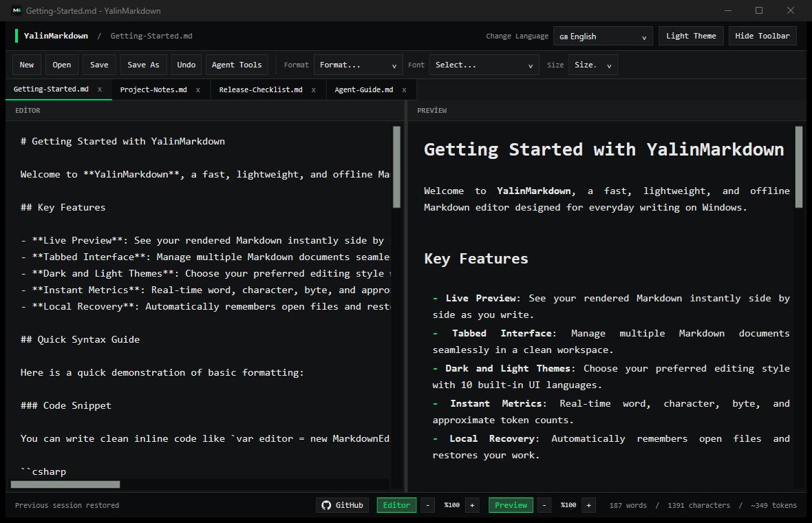

# YalinMarkdown

[](https://github.com/canyrtcn/YalinMarkdown/releases/tag/v0.1.1)  [](LICENSE)  

**Fast, simple, and practical Markdown editing for Windows.**

YalinMarkdown provides a clean workspace for writing Markdown, with an editor and a live preview side by side. Open several documents, make quick edits, and stay focused on the text.



## Features

- **Live preview:** see headings, lists, emphasis, links, and code blocks as you write.
- **Tabbed editing:** open multiple `.md`, `.markdown`, and `.txt` files. Tabs remain in place when selected and can be reordered by dragging.
- **Essential editing tools:** formatting actions, undo, font controls, zoom, and editor-only or preview-only views.
- **Light and dark themes:** switch between two consistent interface styles.
- **10 languages:** English, Turkish, German, French, Spanish, Italian, Chinese, Japanese, Korean, and Russian. English is the initial default.
- **Live statistics:** word and character counts, plus approximate token estimates.
- **Session recovery:** restore open tabs and unsaved edits after restarting.
- **Agent Tools:** review local agent instruction files, estimate token usage, and inspect potential issues in a workspace.

## Download

Check [GitHub Releases](https://github.com/canyrtcn/YalinMarkdown/releases) for Windows builds. A **self-contained Windows x64** executable includes the required .NET runtime, so a separate .NET installation is not needed.

## Build from source

On Windows, install the **.NET 10 SDK** and run:

```powershell
dotnet build .\MarkdownEditor.csproj -c Release
```

To publish a standalone Windows x64 executable:

```powershell
dotnet publish .\MarkdownEditor.csproj -c Release -r win-x64 --self-contained true -p:PublishSingleFile=true -p:PublishTrimmed=false -p:IncludeNativeLibrariesForSelfExtract=true -o .\dist\win-x64-self-contained
```

The standalone executable is larger because it includes the .NET runtime. Trimming is disabled for WPF compatibility.

## Agent Tools

Use **Agent Tools** to analyze an open document or a selected workspace, inspect findings and section-level token estimates, view an approximate merged instruction context, and try keyword-based skill matching.

These checks are heuristic; they are not a full security audit or an exact simulation of an AI agent.

## Current limitations

- Files larger than **8 MiB** cannot currently be opened.
- For large documents, the preview is limited to **80,000 characters or 1,200 lines**. The editor retains the full document content for saving.

## Development checks

```powershell
python tools/audit-source.py
python tools/check-ui.py
dotnet run --project tests/YalinMarkdown.SmokeTests/YalinMarkdown.SmokeTests.csproj -c Release
```

## License

[MIT License](LICENSE) · Maintained by [canyrtcn](https://github.com/canyrtcn).
